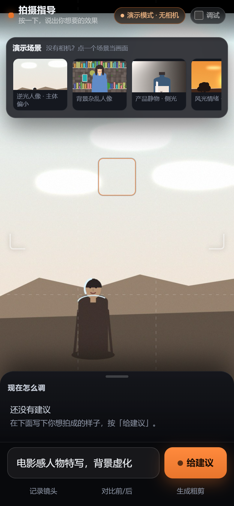
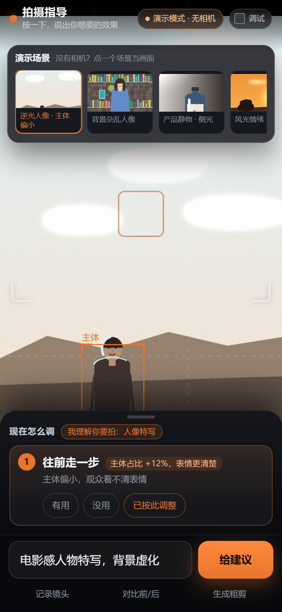
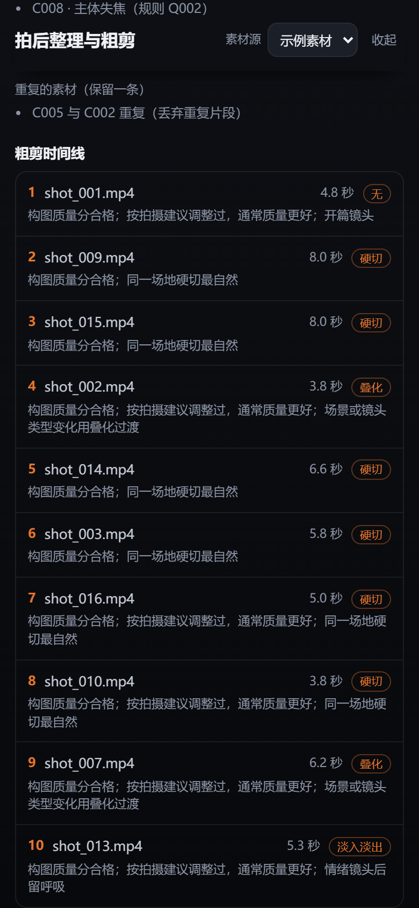

# AI 现场拍摄指导助手 · 手机端原型（v1.2）

> 对准画面，按一下，说出你想拍成什么样 —— AI 看着当前画面，直接告诉你**机位怎么调**（"往前走一步 / 转 45 度 / 换 3.2x"），每条都带一句为什么；拍完自动把素材整理成**粗剪时间线**。
>
> 当前形态：**手机端 Web App（PWA）**，全屏取景 + 底部建议抽屉 + 底部操作条；桌面浏览器打开会自动装进一台 390×844 的手机外壳里，方便录屏和答辩。

| 首页 | 给出建议 | 拍后粗剪 |
|---|---|---|
|  |  |  |

> 截图是在 Edge（Playwright，390×844 手机视口）里真实渲染的，不是设计稿。
> 另外两张是手机链路验证：[07 https 相机模式](docs/screenshots/07-https-camera-mode.png)（假摄像头 → 状态「相机就绪」）与 [08 断网离线壳](docs/screenshots/08-offline-shell.png)。
> 没有相机的机器点"演示场景"里的 5 个竖屏示例画面即可走完全流程。

---

## 1. 现在能做什么（已验证）

| 能力 | 状态 | 说明 |
|---|---|---|
| 手机全屏取景 + 唯一主按钮 | ✅ | 有相机用相机；无相机/未授权自动进"演示模式"（5 个竖屏场景） |
| 说人话 → 3 条可执行动作建议 | ✅ | 5 类镜头意图（人像特写/人物中景/风光/产品/情绪），每条含动作 + 效果提示 + 人话理由 |
| 建议叠加在画面上 | ✅ | 主体框（橙）+ 三分线（虚线），跟随画面重绘 |
| 调试面板（评分/特征/耗时） | ✅ | 默认隐藏，右上角"调试"开关才显示（验收要求界面不出现分数） |
| 调整前 / 调整后对比 | ✅ | 弹层并排 + 下载 PNG |
| 记录镜头（拍中 → 拍后闭环） | ✅ | 记录 `quality_score`、`followed_advice`、采纳的动作 ID，before/after 图落盘 |
| 拍后自动整理 + 粗剪 EDL | ✅ | 废片过滤（抖动/失焦/眨眼/过短/低质）→ 意图加分 → 叙事排序 → 转场建议 → 保留理由；下载 EDL JSON / FFmpeg `.bat` |
| 手机真机 HTTPS 相机 | ✅ | `scripts/start-https.ps1` 自签 CA + 服务器证书；Playwright 假摄像头实测「相机就绪」+ 出建议 |
| 装到手机桌面（PWA） | ✅ | manifest（192/512/maskable 图标）+ Service Worker；Chrome CDP 判定 0 个 installability error |
| 断网离线壳 | ✅ | 断网后界面仍能打开（App Shell），demo 场景帧缓存；接口数据不缓存，避免过期建议 |
| 真实渲染视频 | ❌ | 本机**没有 ffmpeg**：只导出 EDL / FFmpeg 命令 / `.bat`，要在装了 ffmpeg 的机器上渲染（诚实边界） |
| 5 人真实试用 | ⏳ | 需要真人，模板见 [docs/DEMO_SCRIPT.md](docs/DEMO_SCRIPT.md) |

---

## 2. 快速启动（Windows）

```powershell
# 仓库根目录 D:\videoshoot
powershell -ExecutionPolicy Bypass -File scripts\start.ps1
# 然后浏览器打开 http://127.0.0.1:8000
```

- 端口被占用时用环境变量：`$env:PORT=8011; powershell -ExecutionPolicy Bypass -File scripts\start.ps1`
- 只跑算法（不启服务）：
  ```powershell
  python -m engine.suggest_engine --intent "电影感人物特写，背景虚化" --ratio 0.18 --bg 0.42 --light front --gaze 0.3
  python engine/edit_engine.py --json
  ```

### 手机真机：HTTPS + 安装到主屏幕（PWA）

手机浏览器只在**安全上下文（https / localhost）**里允许相机。局域网用 http 打开会退化成演示模式，所以要跑 HTTPS 版本：

```powershell
# 电脑：用自签证书起 HTTPS（0.0.0.0:8443，自动生成 certs/ 下的 CA + 服务器证书）
powershell -ExecutionPolicy Bypass -File scripts\start-https.ps1
# 脚本会打印手机地址，例如 https://172.20.10.7:8443
```

手机（和电脑同一个 Wi-Fi）：

1. 打开 `https://<电脑IP>:8443`；第一次会提示证书不受信任。
2. 两种处理方式，按需要选：
   - **推荐：装一次开发证书**（之后相机、Service Worker、PWA 安装都更稳）
     手机打开 `https://<电脑IP>:8443/api/dev/ca.pem` 下载 `learnbuddy-dev-ca.pem` → 系统设置里安装：
     - Android：设置 → 安全 → 加密与凭据 → 安装证书 → **CA 证书** → 选这个文件（不同 ROM 路径略有差异，搜索"CA 证书"最快）
     - iOS：Safari 下载后在 设置 → 已下载描述文件 → 安装；再到 设置 → 通用 → 关于本机 → 证书信任设置 → 打开完全信任
     装完重新打开 `https://<电脑IP>:8443`，应该不再报错。
   - **快速方式：点「高级 → 继续前往（不安全）」**。能进页面，但**部分浏览器版本会因此限制相机/Service Worker**，演示模式仍完整可用。
3. 相机权限弹窗点允许 → 顶部状态显示「相机就绪」（不再是"演示模式"）。
4. 装到手机桌面：
   - Android Chrome/Edge：右上角菜单 → **安装应用 / 添加到主屏幕**
   - iOS Safari：分享按钮 → **添加到主屏幕**
   装好后从桌面图标全屏打开（没有浏览器地址栏），断网也能打开界面（离线壳）。
5. 断网时：App Shell 与 5 个 demo 场景仍在，但建议/记录/粗剪需要电脑上的服务在跑。

> 桌面 Chrome/Edge 打开 `http://127.0.0.1:8000` 本身就是安全上下文，相机可用，平时开发用 HTTP 就够。
> 证书文件在 `certs/`（含私钥，**只用于本机开发，别提交/外传**）；`certs/ca.pem` 是手机要装的那张。
>
> 📖 **手机 + 电脑的逐步操作、证书安装（Android/iOS）、防火墙、APK 安装与排错表**：见 [docs/PHONE_GUIDE.md](docs/PHONE_GUIDE.md)。

---

## 3. 一分钟走一遍（演示模式）

1. 打开页面 → 顶部"演示模式 · 无相机"；下方一排 5 个竖屏场景（逆光人像 / 背景杂乱 / 产品静物 / 风光黄昏 / 人像特写）。
2. 点"逆光人像 · 主体偏小" → 输入框默认是"电影感人物特写，背景虚化" → 点橙色**给建议**。
3. 底部抽屉出 1–3 条建议，例如：
   - ① 往前走一步 · 主体占比 +12%，表情更清楚 —— 主体偏小，观众看不清表情
   - ② 转 45 度让光扫过侧脸 · 光线转成侧光 —— 侧光能拍出轮廓和质感
4. 点某条的"已按此调整" → 点**记录镜头** → 上方出现 `已记录 S0001` + 调整前/调整后缩略图。
5. 点**生成粗剪** → 全屏面板：总素材/可用/剔除/重复、剔除理由、粗剪时间线（序号/文件名/时长/转场/保留理由）、总时长；可下载 EDL JSON 与 FFmpeg `.bat`。
6. 顶部"调试"开关可看 `current_score` / 特征 / 耗时（平时不打扰用户）。

---

## 4. 目录结构

```
videoshoot/
├── web/                 # 手机端单页（原生 JS，无构建、无 CDN）
│   ├── index.html       # .phone/.screen 手机外壳 + 取景 + 建议抽屉 + 操作条 + 粗剪面板
│   ├── app.js           # 相机/演示模式、抓帧、建议渲染、叠加层、对比、记录、粗剪、SW 注册、安装入口
│   ├── app-config.js    # 运行时配置：window.__LB_API_BASE__（Capacitor/跨源部署时指向电脑）
│   ├── sw.js            # Service Worker：离线 App Shell + demo 场景缓存；接口不缓存
│   ├── styles.css       # 手机优先 UI（safe-area、44px+ 触控、窄屏时间线卡片化）
│   ├── manifest.json    # PWA（standalone / portrait / 图标 / 快捷方式）
│   └── icon.svg + icon-{180,192,512}.png + icon-maskable-512.png
├── server/              # FastAPI 后端
│   ├── app.py           # 路由 + 静态挂载（/ → web，/static，/output，/api/dev/ca.pem）
│   ├── service.py       # 纯业务编排（可被测试直接 import）
│   ├── features.py      # cv2 启发式画面特征 + 主体框（诚实标注"非 MediaPipe"）
│   ├── store.py         # feedback.jsonl / shot_log.csv / before-after 图
│   └── static/demo/     # 5 张 720×1280 竖屏 demo 帧 + scenarios.json
├── engine/              # 决策内核（纯函数，无网络/UI 依赖）
│   ├── suggest_engine.py  # 意图解析 → 4 维评分 → 差距 → 动作 → Top-3
│   ├── edit_engine.py     # 质量过滤 → 闭环加分 → 叙事排序 → 粗剪 EDL
│   ├── edl_export.py      # EDL JSON / FFmpeg 命令 / .bat / CMX3600
│   └── action_effects.py  # 50 个动作的特征影响表（调参旋钮）
├── data/                # 领域知识（引擎的燃料）
│   ├── intent_weights.json  # 5 类意图权重 + 目标区间 + 用户说法关键词
│   ├── rules.json           # 33 条"什么画面给什么动作"规则
│   ├── phrases.json         # 50 条可执行话术（含效果提示与人话理由）
│   ├── edit_rules.json      # 剪辑规则（废片过滤/闭环加分/叙事弧/转场）
│   ├── materials.csv        # 16 条示例素材（含废片/重复/闭环样本）
│   └── shots.csv            # 90 行拉片标注表（教学模板，非实测）
├── certs/               # 开发用 CA + 服务器证书（含私钥，仅本机调试，勿外传）
├── tools/               # demo 帧 / 素材清单 / EDL→ffmpeg / 开发证书 / PWA 图标
├── scripts/             # start.ps1(HTTP) / start-https.ps1(手机真机 HTTPS) / .bat
├── tests/               # 128 个契约测试 + 3 个端到端验收脚本
├── docs/                # 契约、架构、演示脚本、验收报告、截图
├── mobile/              # Capacitor Android 套壳工程（见 mobile/README.md）
├── _tools/              # 只为本机构建 APK 临时装的便携工具链（Node/JDK/Android SDK，约 2 GB，可删）
└── reference/           # 原始方案 HTML + 交付包（只读参考）
```

> `certs/` 里含私钥，**只用于本机开发，不要外传/提交**；`_tools/` 可删，重建 APK 的命令见 [mobile/README.md](mobile/README.md) §8。

---

## 5. 关键设计

1. **不输出坐标，输出动作**："后退两步"比 `(x=2.3, y=1.6)` 有用；主体框只用来让用户看到"AI 在工作"。
2. **不逐帧，点一次抓一帧**：延迟与成本可控；2–5 秒对拍摄指导足够（摄影师本来就在调整）。
3. **拍中 → 拍后闭环**：拍摄阶段记录的 `quality_score` / `followed_advice` / 采纳动作 ID，直接成为剪辑阶段"哪条素材值得留"的依据 —— 这是和其它自动剪辑工具最大的差别。
4. **诚实近似**：特征提取是启发式（肤色/显著性/中心先验 + Canny + 亮度分区），动作效果表是人工近似；全部在代码注释、`/api/health`、本文档写明，不冒充实测精度。

详见 [docs/ARCHITECTURE.md](docs/ARCHITECTURE.md) 与 [docs/INTERFACES.md](docs/INTERFACES.md)（数据/API/UI 字段级契约）。

---

## 6. 测试与验收

```powershell
cd D:\videoshoot
python -m unittest discover -s tests -v        # 131 个契约测试
python tests\acceptance_live.py                # 端到端：HTTP 服务 → 11 项验收 → 停进程
python tests\acceptance_https_pwa.py           # 手机链路：HTTPS + 相机模式 + 离线壳 + 可安装性
```

最近一次结果（2026-11-23）：

- 契约测试：**131/131 通过**（引擎、剪辑、EDL、数据、特征、API、前端静态、PWA、开发证书）
- HTTP 端到端：**11/11 通过**；无相机 demo 帧 → 建议 **72ms** 返回；记录 5 条素材 → 粗剪 5 条、闭环加分 3 条、每条带理由
- 手机链路端到端：**9/9 通过** —— 自签证书链校验、https 下假摄像头「相机就绪」→ 出 3 条建议、Service Worker 接管、断网仍开离线壳、Chrome 判定可安装（0 个 installability error）
- 方案 §10 的 7 条验收：6 条自动验证通过，1 条（5 人试用）需真人执行 → 见 [docs/ACCEPTANCE.md](docs/ACCEPTANCE.md) 与 [docs/DEMO_SCRIPT.md](docs/DEMO_SCRIPT.md)

---

## 7. 已知限制（不粉饰）

1. **没有 ffmpeg**：粗剪只到 EDL / 命令 / `.bat`，不能在本机出 mp4。
2. **HTTPS 是自签证书**：手机第一次访问要装一次开发 CA 或点「继续前往」；部分浏览器/系统版本会因证书警告限制相机或 Service Worker（装 CA 后正常）。公网部署则需要真实证书域名（Vercel/Cloudflare/自有域名）。
3. **iOS 的 PWA 能力有限**：Safari 不支持 `beforeinstallprompt`（用分享 → 添加到主屏幕），Service Worker 支持但缓存策略受系统回收影响；真机体验优先 Android Chrome/Edge。
4. **特征提取是启发式**：本机 OpenCV 5.0 无 Haar XML，人脸检测不可用，主体定位走肤色/显著性/中心先验回退；误差真实存在，别拿 demo 卡通图当精度评测集。
5. **规则覆盖约 80% 常见场景**：无命中时引擎用 `preferred_actions` 兜底，不保证最优；`shots.csv` 是教学模板，不是逐帧实测，不能用来算"一致率"。
6. **`demo` 场景是 cv2 画的卡通示意**（720×1280 竖屏），只用于演示闭环，不是真实素材。
7. **剪辑只映射视频轨**：FFmpeg 命令默认硬切、不含音频；转场信息保留在 EDL 里（notes 说明用 xfade 替换）。
8. **Android APK 不含后端**：APK 里的接口地址指向电脑上的 HTTPS 服务（`web/app-config.js` / 构建时注入），手机和电脑必须同一 Wi-Fi，且电脑要先跑 `scripts/start-https.ps1`；APK 是 **debug 签名**，且**未在真机运行验证过**（本机没有可连手机/模拟器），只做了 `apksigner`/`aapt2` 静态校验。

---

## 8. 下一步（按性价比排序）

1. **真机相机 + PWA 安装**：✅ 本轮完成 —— `scripts/start-https.ps1`（自签 CA）+ Service Worker 离线壳 + 安装到主屏幕，见 §2「手机真机」；实测结果见 [docs/ACCEPTANCE.md](docs/ACCEPTANCE.md)。
2. **打包成 Android App**：✅ 本机已构建出 **debug APK** —— [mobile/shooting-guide-debug.apk](mobile/shooting-guide-debug.apk)（3.62 MiB，包名 `com.learnbuddy.shootingguide`，debug 签名、`apksigner` v1+v2 校验通过）；工程与构建说明见 [mobile/README.md](mobile/README.md)。APK 内置信任开发 CA，WebView 里 `https://localhost` 是安全上下文，相机可用；接口指向电脑的 `https://172.20.10.7:8443`。**未在真机运行验证**（本机无可连手机/模拟器），安装后按 mobile/README §2 检查：界面 → 状态「服务就绪」→ 相机权限弹窗 → 演示模式。
3. **接多模态大模型**：只替换 `engine/suggest_engine.py` 的意图解析一层（`parse_intent`），规则库仍做兜底，控制成本。
4. **真实拉片**：把 `data/shots.csv` 换成真实 30 个镜头实测标注，用 20 张测试图测"专业一致率"，让规则阈值有数据依据。
5. **渲染粗剪**：在装了 ffmpeg 的机器上把 `.bat` 跑通，出 3 分钟演示视频（含调整前后对比）。
6. **正式部署**：把 FastAPI 部署到有证书的域名（如 Cloudflare Tunnel / Vercel 反向代理），手机不再需要装自签 CA。

---

## 9. 文档索引

| 文档 | 用途 |
|---|---|
| [docs/INTERFACES.md](docs/INTERFACES.md) | 数据 / 引擎 / HTTP API / 前端 UI 的字段级契约（改字段先改这里） |
| [docs/ARCHITECTURE.md](docs/ARCHITECTURE.md) | 分层、数据流、闭环、工程设计取舍与诚实标注 |
| [docs/ACCEPTANCE.md](docs/ACCEPTANCE.md) | 方案 §10 七条验收 + 手机链路（HTTPS/PWA）验收结果与证据 |
| [docs/DEMO_SCRIPT.md](docs/DEMO_SCRIPT.md) | 3 分钟演示脚本 + 5 人试用记录表 |
| [docs/PHONE_GUIDE.md](docs/PHONE_GUIDE.md) | **手机 + 电脑逐步操作手册**：HTTPS 启动、证书安装、PWA/APK、数据在哪、排错表 |
| [docs/TEAM_GIT.md](docs/TEAM_GIT.md) | **团队 Git 协作手册**：仓库 NLvideo、三种共享方式、分工、日常流程、冲突处理 |
| [mobile/README.md](mobile/README.md) | Capacitor Android 壳：构建、安装、API 地址、证书、已知限制 |
| [reference/](reference/) | 原始方案 HTML 与三人协作交付包（只读） |

## 10. 团队 Git 仓库（NLvideo）

本目录是一个 Git 仓库（分支 `main`）；**云端公开仓库：<https://github.com/Bridgelief/NLvideo>**（clone 不用登录；push 需接受 Collaborator 邀请）。三种拿代码方式：

```powershell
# A. 同一局域网（仓库主人先启动共享服务，窗口别关）
powershell -ExecutionPolicy Bypass -File scripts\git-serve.ps1
# 队友：git clone http://<电脑IP>:8088/NLvideo.git NLvideo

# B. 文件包（异地/无局域网）
git bundle create D:\NLvideo.bundle --all
# 队友：git clone D:\NLvideo.bundle NLvideo

# C. GitHub（公开仓库，长期协作；所有人都能 clone；写权限需邀请或走 Fork+PR）
git clone https://github.com/Bridgelief/NLvideo.git NLvideo
```

本机 remote：`origin` = GitHub，`lan` = `D:\NLvideo.git`（内网共享用）。
日常：`git pull --rebase` → 改 → `git add -A` → `git commit -m "模块：做了什么"` → `git push`。
证书私钥、`_tools/`、`node_modules/`、`output/` 均已在 `.gitignore` 排除；仓库地址、邀请协作者、冲突处理见 [docs/TEAM_GIT.md](docs/TEAM_GIT.md)。

---

> 版本 v1.3（2026-11-23）：补上手机真机链路 —— 局域网 HTTPS（自签 CA，真机可用相机）、PWA 可安装 + Service Worker 离线壳、Capacitor Android 套壳工程。
> v1.2（2026-11-22）：手机优先 UI 全屏取景 + 底部建议抽屉 + 粗剪面板，桌面端渲染为手机外壳。
